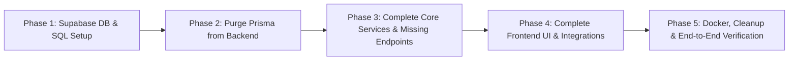

> Parity completion — 14 November 2026: session/device controls and security activity are implemented on `codex/account-sharing-completion`; 235 tests pass with one existing skip. Hosted security migrations are applied; frontend/API source is not merged or deployed. The full remaining objective and evidence stay in docs/PARITY_COMPLETION_PLAN.md.

> Device and currency release — 12 November 2026: implemented foreign-amount entries/rate snapshots, encrypted passcode-protected private/cloud device workspaces, durable offline finance and shared-operation queues, full device archives including receipts, four language catalogs/RTL, native app bundles and private widget bridges. iOS simulator compilation passes after Xcode license acceptance; native runtime/Android builds and remaining English help/error translations remain acceptance work. See docs/DEVICE_WORKSPACES.md and VERIFICATION.md. Merged to `main` and deployed on 12 November 2026; native store publication remains separate.

> Personal finance release — 11 November 2026: added flexible budgets/payday plans, assets, private loans, events, reviewed personal bills, card terms/statements, labels/subcategories, bulk/manual multi-account workflows, PDF/Excel reports and savings milestones. See docs/MONEY_MANAGER_PARITY.md for the one-to-one comparison and remaining gaps; this is not full Money Manager parity. Frontend/API source is on the release branch; hosted migrations are applied. See VERIFICATION.md for evidence.

> Design and usability release — 2 November 2026: implemented the Gunawan Santoso Money Manager-inspired interface, five mobile tabs, spending calendar, Decimal calculator, local-date history filters, and inline shared balances. Updated dependency patches. See DESIGN_RESEARCH.md and VERIFICATION.md for evidence and remaining checks.

> Additional release — 2 November 2026: added monthly budgets and dashboard alerts, account-linked savings goals, advanced transaction search/pagination/CSV export, live category reports, group activity/comments, and an installable responsive web app with a private offline fallback. See README.md and VERIFICATION.md for setup and checks.

> Next release — 2 November 2026: implemented invitation links with owner approval, reusable group split templates, and recurring expense drafts. Hosted migrations and the hourly Supabase Cron job are applied. See README.md for behavior/API/setup and VERIFICATION.md for live test results. The older audit below is retained as historical context.

> Implementation status — 1 November 2026: the application now uses hosted Supabase in Mumbai, Supabase Auth, and atomic PostgreSQL accounting RPCs. Docker was removed at the user's request. The original audit below records the starting state; see README.md and VERIFICATION.md for the delivered architecture, checks, and remaining provider/UI verification limits.

# Project Audit & Implementation Plan: Supabase Migration & Feature Roadmap

## 1. Executive Summary

The project is a **Hybrid Personal Expense Manager & Splitwise Web Application**.
Its primary value proposition is unifying personal double-entry ledger bookkeeping (Assets, Liabilities, Receivables, Payables) with group expense splitting (equal, exact, percentage, shares, multi-payer) and automated debt simplification (Min-Cash-Flow algorithm).

This audit evaluates the codebase in its current state across the backend, frontend, database, and devops layers, identifies all technical debt and feature gaps, and outlines an end-to-end plan to **completely eradicate Prisma in favor of direct Supabase integration**, complete missing features, and unify the application.

---

## 2. Comprehensive Codebase Audit

### 2.1 Current Architecture Overview

```mermaid
flowchart TD
    subgraph Client ["Frontend (Next.js 16 App Router)"]
        UI[Tailwind CSS v4 + Lucide UI]
        RQ[TanStack React Query v5]
        ZS[Zustand Auth Store (localStorage)]
        UI --> RQ
        UI --> ZS
    end

    subgraph API ["Current Backend (Express 5 + TypeScript)"]
        Routes[Express Route Handlers]
        AuthMW[JWT Auth Middleware]
        Services[Split Engine & Settlement Services]
        PrismaORM["Prisma Client ORM (TO REMOVE)"]
        Routes --> AuthMW
        Routes --> Services
        Services --> PrismaORM
        Routes --> PrismaORM
    end

    subgraph DB ["Current Database"]
        PG[(PostgreSQL 16 via Docker)]
        PrismaORM --> PG
    end

    Client -->|HTTP REST / JWT| Routes
```

---

### 2.2 Feature Status Matrix

| Feature Area                  | Backend Status | Frontend Status | Overall Status                         | Notes & Gaps                                                                                                                                                                                                                                                        |
| :---------------------------- | :------------- | :-------------- | :------------------------------------- | :------------------------------------------------------------------------------------------------------------------------------------------------------------------------------------------------------------------------------------------------------------------ |
| **Authentication & Profile**  | ✅ Done        | ✅ Done         | **Needs Integration**                  | Email/Password & Google OAuth work. Token stored in localStorage. Profile display works, but `displayCurrency` and `timezone` updates in Settings have no frontend mutation.                                                                                        |
| **Personal Accounts (Vault)** | ✅ Done        | ⚠️ Partial      | **Needs Integration**                  | Backend has full CRUD. Frontend can list and create, but cannot edit, delete, or view account transaction history. Hardcoded to USD.                                                                                                                                |
| **Personal Transactions**     | ⚠️ Partial     | ❌ Missing      | **Needs Re-planning & Implementation** | Backend has `POST /transactions`, `GET /transactions`, and `POST /transactions/transfer`. **Zero frontend UI exists** for transaction history, filtering, or manual entry. Backend lacks `GET /:id`, `PUT /:id`, `DELETE /:id`.                                     |
| **Categories**                | ⚠️ Partial     | ❌ Missing      | **Needs Re-planning & Implementation** | Backend supports creating and listing user/default categories. Frontend has no category management, and transaction/split forms do not offer category pickers.                                                                                                      |
| **Groups Management**         | ⚠️ Partial     | ⚠️ Partial      | **Needs Integration**                  | Creating groups and listing them works. Group member addition (`POST /groups/:id/members`) exists in backend, but frontend "Add Member" button has no handler. No group edit/delete or member removal.                                                              |
| **Expense Splitting Engine**  | ✅ Done        | ⚠️ Partial      | **Needs Re-planning & Integration**    | Backend service (`splitExpenseService.ts`) calculates EQUAL, EXACT, PERCENTAGE, and SHARES correctly. However, frontend `SplitBuilder.tsx` only works for EQUAL splits; inputs for EXACT/PERCENTAGE/SHARES are uncontrolled and unmapped. Multi-payer UI is absent. |
| **Debt Simplification**       | ✅ Done        | ✅ Done         | **Done**                               | Pure algorithm (`debtSimplification.ts`) calculates Min-Cash-Flow. Frontend displays debt graph under Group Details. Needs better user labeling (shows single characters).                                                                                          |
| **Settlements Engine**        | ⚠️ Partial     | ❌ Missing      | **Needs Integration**                  | Backend has `POST /settlements` with dual-ledger balance updates. Frontend "Settle Up" buttons are non-functional placeholders.                                                                                                                                     |
| **Smart Reminders**           | ✅ Done        | ⚠️ Partial      | **Needs Integration**                  | Reminders bell dropdown exists in top bar and can mark complete/read. However, no UI exists to create or delete reminders.                                                                                                                                          |
| **Analytics & Cash Flow**     | ⚠️ Partial     | ❌ Mocked       | **Needs Re-planning & Implementation** | Backend endpoints (`/net-worth`, `/cash-flow`, `/debt-summary`) work. Frontend Analytics page renders hardcoded static bars and fake "+4.2%" trends without calling `/cash-flow`.                                                                                   |
| **Hybrid Dual-Entry Ledger**  | ⚠️ Partial     | ⚠️ Partial      | **Needs Re-planning**                  | Creates virtual `ACCOUNTS_RECEIVABLE` / `ACCOUNTS_PAYABLE` accounts upon split creation, but lacks reverse reconciliation on deletion/edit.                                                                                                                         |

---

### 2.3 Critical Technical Deficits & Inconsistencies Discovered

1. **Prisma Schema vs. SQL Migration Mismatch (High Risk)**:
   - The Prisma schema defines 11 models: `User`, `Account`, `Category`, `Transaction`, `Group`, `GroupMember`, `SplitExpense`, `SplitPayer`, `SplitParticipant`, `Reminder`, `Settlement`, `AuditLog`.
   - The SQL migration folder (`backend/prisma/migrations/`) only creates 9 tables. Tables `Reminder`, `Settlement`, `AuditLog`, and the column `Transaction.linkedTransactionId` were pushed with `prisma db push` and **never written into migrations**.
2. **Deep Prisma Coupling Across Backend**:
   - `backend/src/db.ts`: Initialises `PrismaClient`.
   - `backend/src/utils/money.ts`: Hard-depends on `Prisma.Decimal` and `Prisma.Decimal.Value`.
   - 11 route and service files make 50+ explicit `prisma.<model>.<op>` calls.
   - Interactive transactions (`prisma.$transaction(async (tx) => ...)`) are used in 3 core business routines (`splitExpenseService`, `settlementService`, and `transaction.routes.ts` transfers).
3. **Frontend UI State Incompleteness**:
   - No Transactions page: The app is half an expense manager, but users cannot view their personal transactions feed.
   - SplitBuilder UI is uncontrolled for non-equal splits: entering percentages or exact amounts doesn't sync to the payload.
   - Sidebar active state is hardcoded to "Home".
   - Unused dependencies installed in frontend: `framer-motion`, `recharts`, `clsx`, `tailwind-merge`.

---

## 3. Target Architecture: Direct Supabase Integration

### 3.1 Architectural Decision: How to Use Supabase "Directly"

There are two primary paradigms when migrating to Supabase without Prisma:

| Architectural Option                                                                     | Pros                                                                                                                                                                                     | Cons                                                                                                                                                                                          | Recommendation                             |
| :--------------------------------------------------------------------------------------- | :--------------------------------------------------------------------------------------------------------------------------------------------------------------------------------------- | :-------------------------------------------------------------------------------------------------------------------------------------------------------------------------------------------- | :----------------------------------------- |
| **Option A: Pure BaaS (Frontend directly to Supabase via `@supabase/ssr` + RLS)**        | Zero Express backend needed; real-time subscriptions out of the box; built-in auth; less infrastructure.                                                                                 | Complex business logic (split calculations, double-entry ledger entries, debt simplification) must live either in client or PostgreSQL PL/pgSQL stored procedures (RPC). Harder to unit test. | **Recommended for Auth, CRUD, & Realtime** |
| **Option B: Backend Express API using `@supabase/supabase-js` / Postgres Pool directly** | Keeps business logic in TypeScript services (`splitExpenseService`, `debtSimplification`); zero client-side architectural overhaul; easy vitest tests.                                   | Still requires running and hosting two services (Express + Next.js).                                                                                                                          | **Recommended Hybrid Transition**          |
| **Option C: Unified Next.js Fullstack with `@supabase/ssr` + Supabase Database Client**  | Single deployment, eliminates Express container entirely, uses Next.js Route Handlers / Server Actions for complex TypeScript transactions and direct Supabase client for standard CRUD. | Requires consolidating Express routes into Next.js App Router API routes (`src/app/api/...`).                                                                                                 | **Optimal Long-Term Architecture**         |

### Recommended Migration Path:

1. **Database Layer**: Deploy schema directly into Supabase (PostgreSQL) using declarative SQL scripts with Row Level Security (RLS) policies.
2. **Eliminate Prisma**: Replace `@prisma/client` with `@supabase/supabase-js` (using Supabase's JS SDK queries: `supabase.from('table').select(...)`, `.insert(...)`, `.update(...)`, `.delete(...)`).
3. **Precision Math**: Replace `Prisma.Decimal` in `money.ts` with standard `decimal.js`.
4. **Complex Transactions**: Implement PostgreSQL RPC functions or Supabase batch transactions for the multi-table operations (Split Creation + Ledger Entries, Settlement + Balance Transfers).
5. **Phase out Express / or Clean Service Adapter**: Replace Prisma in backend routes with Supabase Admin/Client queries, and optionally prepare for Next.js unified route handlers.

---

## 4. Phase-by-Phase Implementation Roadmap



### Phase 1: Database Migration to Supabase

- [x] Create consolidated SQL migration script including all 11 tables with correct constraints, foreign keys, and indexes:
  - `users`, `accounts`, `categories`, `transactions` (with `linked_transaction_id`), `groups`, `group_members`, `split_expenses`, `split_payers`, `split_participants`, `reminders`, `settlements`, `audit_logs`.
- [x] Ensure money columns use standard `NUMERIC(14, 2)` and share values use `NUMERIC(14, 4)`.
- [x] Configure PostgreSQL Row-Level Security (RLS) policies for each table so each user only reads and modifies their own data and their group data.
- [x] Write PostgreSQL RPC functions for atomic accounting actions:
  - `create_split_expense_atomic`: Records split expense, payers, participants, and balances.
  - `execute_settlement_atomic`: Records settlement and adjusts payer/payee cash & AR/AP balances.
  - `transfer_accounts_atomic`: Adjusts balances of source and destination accounts and creates linked transactions.

### Phase 2: Complete Removal of Prisma from Backend

- [x] Uninstall `@prisma/client`, `prisma`, and remove `prisma.config.ts`, `backend/prisma/` directory, and all Prisma npm scripts.
- [x] Install `@supabase/supabase-js` and `decimal.js`.
- [x] Rewrite `backend/src/db.ts` to export an authenticated Supabase client (`getSupabaseClient(req)` or `supabaseAdmin`).
- [x] Rewrite `backend/src/utils/money.ts` using `decimal.js` instead of `Prisma.Decimal`.
- [x] Refactor all 11 route files from Prisma syntax to Supabase query builder syntax:
  - `auth.routes.ts`: `supabase.from('users').insert(...)` / `.select(...)`
  - `account.routes.ts`: `.select()`, `.insert()`, `.update()`, `.delete()`
  - `transaction.routes.ts`: RPC or Supabase queries for transfers and list/create
  - `category.routes.ts`: `.select()`, `.insert()`
  - `group.routes.ts`: `.select()`, `.insert()`
  - `split.routes.ts`: Call `create_split_expense_atomic` or Supabase queries
  - `settlement.routes.ts`: Call `execute_settlement_atomic`
  - `reminder.routes.ts`: `.select()`, `.insert()`, `.update()`, `.delete()`
  - `analytics.routes.ts`: Aggregate queries via Supabase client
  - `user.routes.ts`: Profile fetch and update

### Phase 3: Implement Missing Backend Endpoints

- [x] `transaction.routes.ts`: Add `GET /api/transactions/:id`, `PUT /api/transactions/:id`, `DELETE /api/transactions/:id` (with account balance reversal).
- [x] `group.routes.ts`: Add `GET /api/groups/:id`, `PUT /api/groups/:id`, `DELETE /api/groups/:id`, `DELETE /api/groups/:groupId/members/:userId`.
- [x] `category.routes.ts`: Add `PUT /api/categories/:id`, `DELETE /api/categories/:id`.
- [x] `split.routes.ts`: Add `DELETE /api/splits/:id` and `PUT /api/splits/:id` with balance rollback.
- [x] `analytics.routes.ts`: Add time-series / monthly cash-flow grouping support.

### Phase 4: Frontend Gaps & UI Completion

- [x] **Transactions View (`/transactions`)**:
  - Build transactions page with filters (type, account, category, date range).
  - Add "Add Transaction" modal (income, expense) and "Transfer Between Accounts" modal.
- [x] **SplitBuilder Overhaul (`src/components/split/SplitBuilder.tsx`)**:
  - Hook up state for `EXACT`, `PERCENTAGE`, and `SHARES` inputs with validation.
  - Add payer selection dropdown (who paid vs default "You").
  - Add category picker.
- [x] **Settlements UI**:
  - Wire the "Settle Up" button on Dashboard and Group Details to a Settlement modal.
  - Allow selecting paying account and settlement method.
- [x] **Group Management**:
  - Implement "Add Member" modal in Group Details (`POST /groups/:id/members`).
  - Add member selection in group creation modal.
  - Map group member names onto the Simplified Balances graph instead of single initials.
- [x] **Analytics Page (`/analytics`)**:
  - Connect live data using `useQuery` for `/analytics/cash-flow`.
  - Replace mocked HTML bar chart with responsive interactive charts (using `recharts` which is already installed).
  - Activate time range toggles (1W, 1M, 3M, 1Y, ALL).
- [x] **Settings Page (`/settings`)**:
  - Wire currency selector and timezone dropdown to `PUT /users/profile`.
- [x] **Sidebar & Navigation**:
  - Fix hardcoded active tab using `usePathname()` from Next.js navigation.
  - Add `/transactions` link to navigation.

### Phase 5: Verification, Docker & Configuration

- [x] Remove Docker Compose and Dockerfiles; use hosted Supabase exclusively, per the updated user instruction.
- [x] Update `.env.example` in both backend and frontend with Supabase URL and anon/service keys.
- [x] Remove Dockerfiles and all Prisma generation/deployment steps.
- [x] Run vitest unit tests (`backend/src/services/splitExpenseService.test.ts`, `backend/src/app.test.ts`) and add Supabase integration tests.
- [ ] Complete the remaining interactive UI walkthroughs. Hosted accounting/API flows and browser smoke checks for authentication, transactions, and analytics passed.

---

## 5. Verification & Testing Plan

### Automated Tests

- Backend Unit Tests: `npm test -w backend` (Vitest)
  - Verify `splitExpenseService` calculation logic with `decimal.js`.
  - Verify `debtSimplification` algorithm.
  - Verify Zod schema validation.
- Build Tests:
  - `npm run build -w backend` (TypeScript compile check).
  - `npm run build -w frontend` (Next.js production build check).

### Manual Verification Flows

1. **Authentication**: Register new user, log in, verify JWT / Supabase session token persistence.
2. **Account Creation & Transfer**: Create two accounts (Checking, Savings), perform a transfer, check that both balances and linked transactions are created.
3. **Split Expense Flow**:
   - Create a group, add two test members.
   - Add an Equal split expense of $90.
   - Verify payer balance reflects outflow and other members have debt entries.
   - Add a Percentage split (60/40) of $100 and check balances.
   - View the Simplified Debt graph.
4. **Settlement**: Trigger "Settle Up", pay debt, verify both accounts and debt graph update to $0 balance.
5. **Analytics**: Visit `/analytics`, verify cash flow chart reflects income vs expense transactions.
